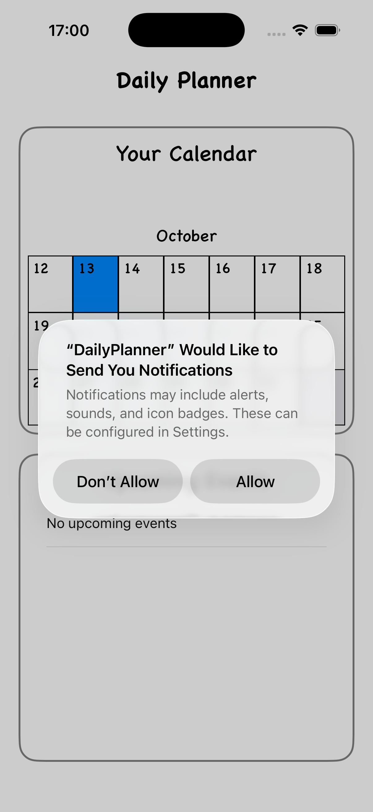
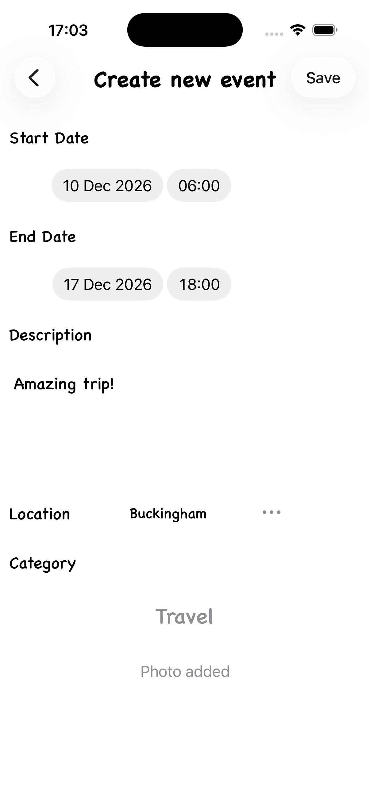
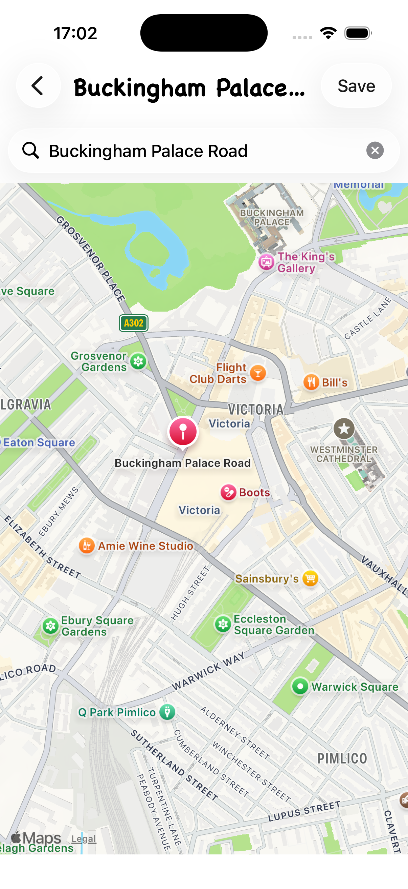
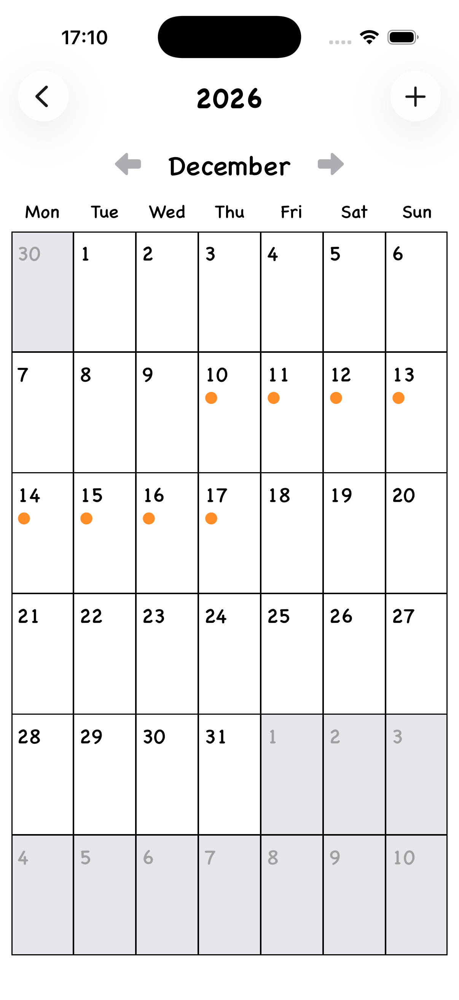
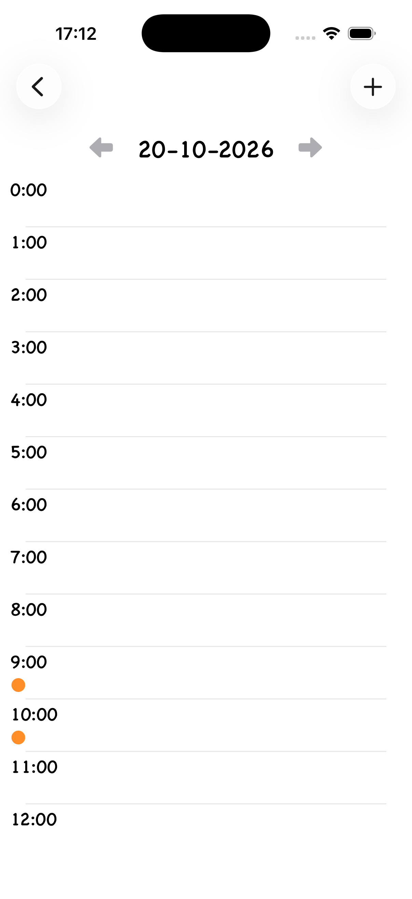
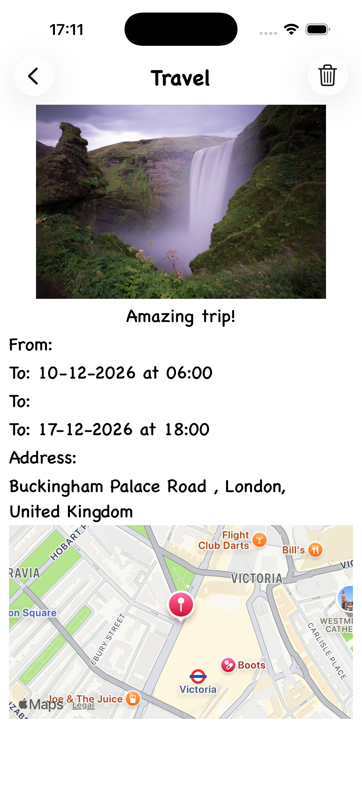
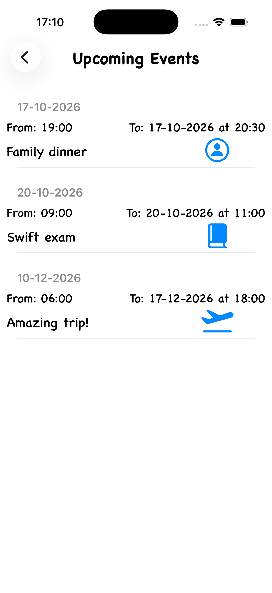
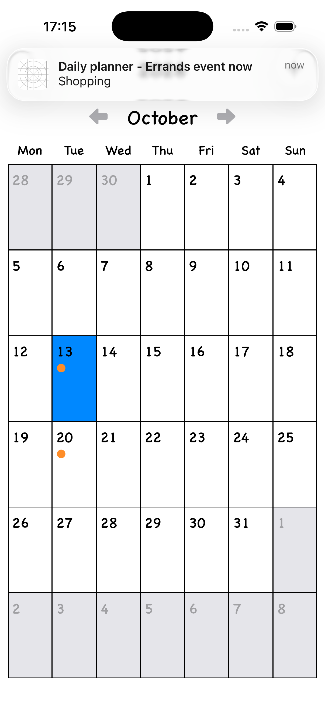

### DailyPlanner
Native iOS Swift app.

### Technologies
- Swift
- Xcode
- UIKit
- CoreData
- UserNotifications
- MapKit

### Features
- Tracking user's events
- Possibility of choosing event's location on map
- Sending notifications 24 hours before, one hour before and at the moment of the beginning of the event
- Different categories of events
- Photos from library or camera
- Deleting events which are no longer valid
- Calendar with user's previous and upcoming events

### UI screenshots

### App start

### Event creating

### Location choosing

### Calendar

### Day overview

### Checking existing events

### Upcoming events overview

### Notification sending

